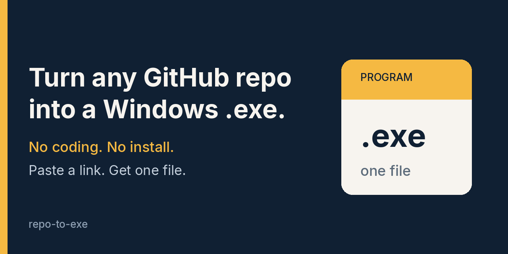

# Turn any GitHub repo into a Windows .exe. No coding.

Paste a link to a public GitHub project. You get back one file you can run on Windows. Nothing else to install.

# [Make me an .exe](https://github.com/PalmCoast/repo-to-exe/issues/new?template=build-exe.yml)

## How it works

1. Click **Make me an .exe**.
2. Paste the link to a public project on GitHub.
3. Come back to that issue. I'll leave a download link after I run the program once on a Windows machine.

## Ready-made programs

Each one was built, then run once on a clean Windows machine, before it was published.

| Program | What it does | Original project | Download |
|---|---|---|---|
| tldr | Short, plain-English cheat sheets for terminal commands | [tldr-pages/tldr-python-client](https://github.com/tldr-pages/tldr-python-client) (Python, MIT) | [tldr.exe](https://github.com/PalmCoast/repo-to-exe/releases/download/tldr-c33ca6d/tldr.exe) |
| hey | Load-tests a website by sending it lots of requests | [rakyll/hey](https://github.com/rakyll/hey) (Go, Apache-2.0) | [hey.exe](https://github.com/PalmCoast/repo-to-exe/releases/download/hey-5626f79/hey.exe) |
| http-server | Shares a folder as a website on your computer, with no setup | [http-party/http-server](https://github.com/http-party/http-server) (Node.js, MIT) | [http-server.exe](https://github.com/PalmCoast/repo-to-exe/releases/download/http-server-0d3b7bb/http-server.exe) |

Save the file, open that folder, click the address bar, type `cmd`, and press Enter. Then type the program name, for example `tldr.exe --help`.

These are unofficial builds. Credit goes to the original authors. Each download page also has the test log, a checksum, and the original license.

## Limits, honestly

- The files are **not signed**. The first time you open one, Windows may say "Windows protected your PC". Click **More info**, then **Run anyway**.
- Most of these programs don't open a window. They run in a terminal.
- Programs that need special native pieces (a compiler, a system library, or a Node add-on) can fail. I'll say so on the issue instead of sending a broken file.
- Public GitHub projects only. Private projects and links outside github.com are turned down.
- Very large projects (over about 80 MB) and programs bigger than 200 MB are turned down. A build that runs longer than 20 minutes is stopped.
- One build per request.

## On your own project

Copy [`templates/exe-release.yml`](templates/exe-release.yml) to `.github/workflows/exe-release.yml` in your project.

Publish a version tag that starts with `v`, such as `v1.2.3`. GitHub then builds a Windows `.exe`, runs it once, and attaches it to that version's release. You can also open the Actions tab in your project and click **Run workflow**.

## License

MIT. See [LICENSE](LICENSE).
